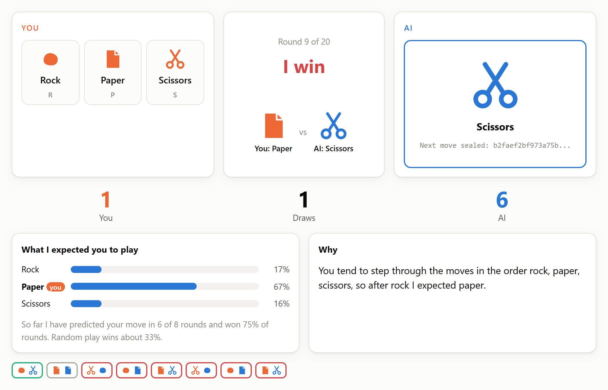
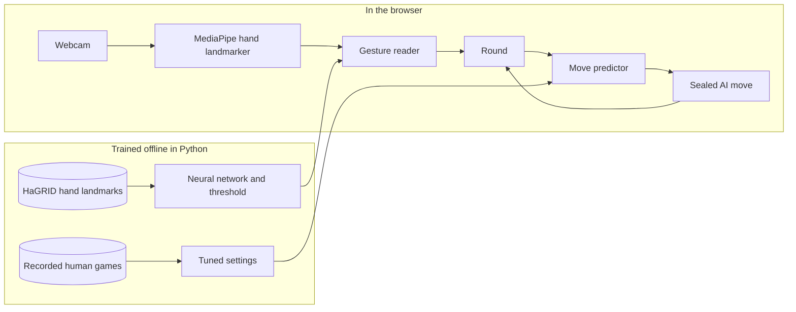
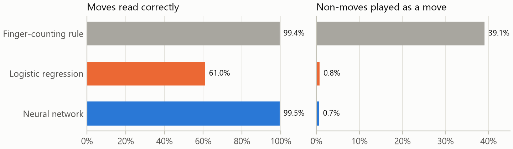
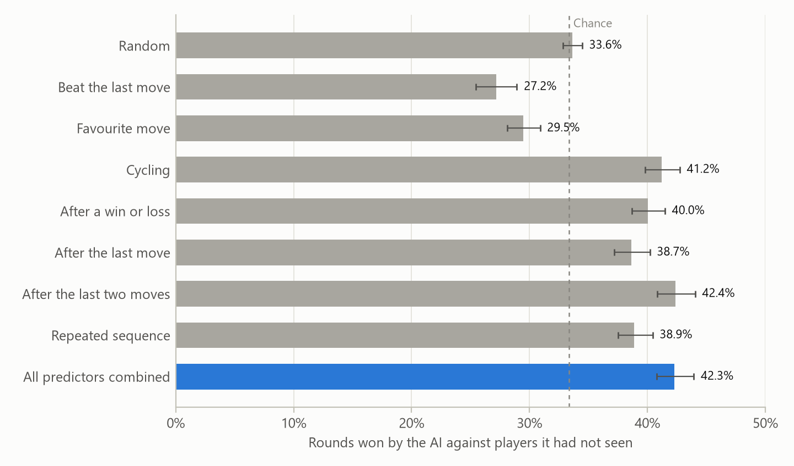
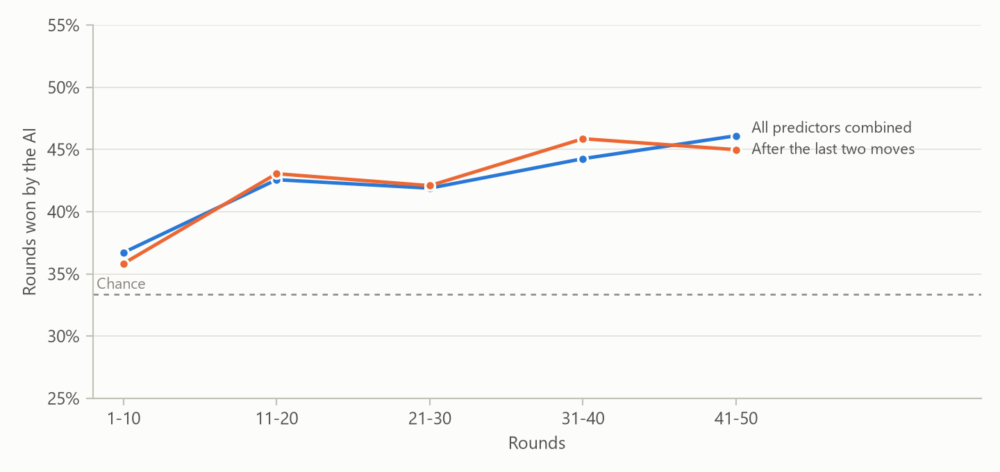

# Rock, paper, scissors AI

A webcam game of rock, paper, scissors against an AI that learns your habits as you play. A small neural network reads your hand from MediaPipe's hand landmarks, and seven online predictors work out what you are likely to play next. The AI seals each move with a SHA-256 hash before you show yours, so you can check it never peeks.

**[Play it in your browser](https://samiicodes.github.io/rock-paper-scissors-ai/)**, with your webcam or with buttons. Everything runs in the page: there is no server, and your video never leaves your device.

The repository also holds the Python package behind the game. It trains the gesture reader on hand landmarks from 17,473 people, tests the move predictor on 249 people's recorded games, and checks that the Python and JavaScript versions of both models give identical answers.



## Contents

- [How it works](#how-it-works)
- [Results](#results)
- [Data](#data)
- [Getting started](#getting-started)
- [Project structure](#project-structure)
- [Limitations](#limitations)
- [Future improvements](#future-improvements)
- [Licence](#licence)

## How it works



1. **Read the hand.** MediaPipe finds 21 points on your hand in each webcam frame. The game rotates, scales, and mirrors them into a standard position and passes the 40 resulting numbers to a neural network with 7,044 parameters, which outputs rock, paper, scissors, or not a move. The frames after "Shoot!" vote, and an unclear hand is asked for again.
2. **Predict the next move.** Seven experts each model one habit: a favourite move, cycling through the moves, reacting to a win or loss, what follows your last one or two moves, repeated sequences, or no pattern at all. A combiner trusts each expert according to its recent log loss, and the AI plays the move with the best expected score against the combined forecast.
3. **Prove it did not cheat.** Before each round the AI shows the SHA-256 hash of its move joined to a random code, and reveals both after your move is read. Hashing the revealed text gives the fingerprint you saw before you played.
4. **Explain itself.** After each round the game shows what it expected and which habit it relied on, such as "After a loss you tend to switch to the move that beats your last one."

The same predictor and gesture reader exist in Python, for training and evaluation, and in JavaScript, for the game. Fixtures written by the Python pipeline are replayed by the JavaScript tests, which require agreement to 1e-12. [docs/architecture.md](docs/architecture.md) covers the design in detail.

## Results

All numbers come from [docs/evaluation_report.md](docs/evaluation_report.md), which `scripts/train_and_evaluate.py` generates. [docs/model_card.md](docs/model_card.md) describes both models.

### Reading hands

On 19,877 test hands from 2,236 people the models never saw:

| Reader | Accuracy | Moves read correctly | Non-moves played as a move | Wrong moves |
| --- | --- | --- | --- | --- |
| Finger-counting rule | 89.75% | 99.44% | 39.08% | 9.96% |
| Logistic regression | 98.01% | 61.01% | 0.78% | 0.21% |
| **Neural network** | **99.43%** | **99.46%** | **0.66%** | **0.20%** |

- **Counting fingers is not enough.** A hand-written rule reads real moves as well as the network, but it plays 39% of thumbs up, pointing fingers, and relaxed hands as rock, paper, or scissors.
- **A linear model is not enough either.** To keep wrong moves at 0.25%, logistic regression has to reject 39% of real moves. The network rejects 0.5%.
- **The network ignores the shape of the photo.** The training photos' aspect ratios are not recorded, so the network was trained on hands stretched by random factors. Its accuracy is 99.4% at every stretch from 0.5 to 2.



### Predicting people

Replayed against 249 recorded players it never saw, 50 rounds each, with 95% intervals over players:

| AI strategy | Won | Drawn | Lost |
| --- | --- | --- | --- |
| Random | 33.6% (32.8 to 34.5) | 33.0% | 33.4% |
| Beat the player's last move | 27.2% (25.4 to 28.9) | 35.9% | 37.0% |
| Best single expert: after the last two moves | 42.4% (40.9 to 44.0) | 30.3% | 27.3% |
| **All predictors combined** | **42.3% (40.8 to 43.9)** | **30.6%** | **27.1%** |



How to read these numbers:

- **People are predictable.** The combined AI wins 42.3% of rounds and loses 27.1%, a net score of +15.2 points, where random play scores zero.
- **It learns during the game.** It wins 36.7% of the first ten rounds and 46.1% of rounds 41 to 50.
- **The obvious strategy backfires.** Playing what beats the player's last move loses more than it wins, because people rarely repeat a move: only 28.2% of the time, against 33.3% for random play.
- **Combining is about robustness, not peak score.** The combined AI matches the best single expert on wins, with better-calibrated probabilities, without having to know in advance which habit a player has.



The recorded players repeated a move more often after winning with it, 30.6% of the time, than after losing with it, 26.5%: the win-stay, lose-shift pattern found in earlier studies of the game.

## Data

| Dataset | Used for | Licence | In this repository |
| --- | --- | --- | --- |
| [HaGRID v2](https://github.com/hukenovs/hagrid) annotations | Training and testing the gesture reader | A variant of CC BY-SA 4.0 | No. The trained weights are, under CC BY-SA 4.0. |
| Recorded games by Komai, Kurokawa, and Kim, [kuro-lab/RPSdata](https://github.com/kuro-lab/RPSdata) | Tuning and testing the move predictor | None stated | No |

`make data` downloads both and checks their SHA-256 sums: 719 MB of HaGRID annotations, without the images, and the recorded games at a pinned commit. The recorded games have no licence, so they are used for evaluation only and never committed. Nothing in the game is trained on them beyond five tuned settings.

- Anton Nuzhdin, Alexander Nagaev, Alexander Sautin, Alexander Kapitanov, and Karina Kvanchiani. *HaGRIDv2: 1M Images for Static and Dynamic Hand Gesture Recognition.* arXiv:2412.01508, 2024.
- Alexander Kapitanov, Karina Kvanchiani, Alexander Nagaev, Roman Kraynov, and Andrei Makhliarchuk. *HaGRID: HAnd Gesture Recognition Image Dataset.* WACV 2024.
- Komai, Kurokawa, and Kim. *Human Randomness in the Rock-Paper-Scissors Game.* Applied Sciences 12(23), 12192, 2022. [doi:10.3390/app122312192](https://doi.org/10.3390/app122312192)

## Getting started

### Requirements

- Python 3.12 or newer and [uv](https://docs.astral.sh/uv/) 0.13 or newer
- Node.js 24 or newer
- GNU Make, optional because each target is one or two commands. On Windows, `winget install ezwinports.make` installs it.

### Play locally

```bash
make install   # Python and JavaScript dependencies, and the pre-commit hooks
make play      # http://127.0.0.1:8000
```

Browsers only allow webcam access on secure pages, and `127.0.0.1` counts as one. The trained models are in the repository, so playing needs no data or training.

### Train and evaluate

```bash
make data    # download and verify both datasets
make train   # train, tune, test, and write the game files and the report
make docs    # the same, then copy the report and figures into docs/
```

The whole pipeline takes about three minutes on a laptop CPU and prints:

```text
Found data/raw/hagrid_annotations.zip
Found data/raw/rpsdata.zip
Drew 80,000 train hands from 17,473 people
Drew 11,923 val hands from 1,300 people
Drew 19,877 test hands from 2,236 people
Training logistic regression
Training the neural network
Finger-counting rule: test accuracy 89.75%
Logistic regression: test accuracy 98.01%
Neural network: test accuracy 99.43%
Skipped player 294: 50 moves against 49 computer moves
Loaded 499 players: 250 for tuning, 249 for testing
Tuning the predictor
Chose decay 0.9, prior 1, learning rate 1, score decay 0.95, margin 0
Random: wins 33.6% of rounds
...
All predictors combined: wins 42.3% of rounds
Wrote the game files to web/models
Report written to reports/evaluation_report.md
Done
```

### Test and lint

```bash
make test   # pytest with coverage, then the JavaScript tests
make lint   # ruff, mypy in strict mode, Biome, and the TypeScript check of the JavaScript
make e2e    # play a whole match and start the camera in a headless browser
```

The 82 Python tests cover 99% of the package. They build synthetic hands and games in archives laid out like the real downloads and run the whole pipeline on them, so they need no data. The 57 JavaScript tests include the parity checks against the Python fixtures. The browser tests play a 20-round match, check every seal against its reveal, and run the hand tracker on a fake webcam. To use an installed browser instead of downloading one, set `E2E_CHANNEL=msedge` or `chrome`.

## Project structure

```text
rock-paper-scissors-ai/
├── config/config.yaml           Downloads, training, tuning, and output settings
├── data/                        Downloads and cached landmarks, not committed
├── docs/                        Architecture, model cards, evaluation report
├── reports/                     Output of the latest local run, not committed
├── scripts/
│   ├── download_data.py
│   └── train_and_evaluate.py
├── src/rpsai/
│   ├── hagrid.py                HaGRID annotations and balanced samples
│   ├── landmarks.py             Hands in a standard position
│   ├── gestures.py              The finger rule, the network, thresholds, metrics
│   ├── gesture_pipeline.py      Training and testing the readers
│   ├── humans.py                The recorded games
│   ├── predictors.py            The experts and the combiner
│   ├── simulation.py            Replays, bootstrap intervals, tuning
│   ├── predictor_pipeline.py    Tuning and testing the predictor
│   ├── export.py                Game files and parity fixtures
│   ├── plotting.py, reporting.py
│   └── pipeline.py              Everything in order
├── tests/                       Unit tests and an end-to-end pipeline test
├── web/
│   ├── index.html, styles.css
│   ├── src/                     The game: camera, gesture reader, predictor, match
│   ├── models/                  The trained gesture reader and predictor settings
│   ├── test/                    Unit and parity tests, with the Python fixtures
│   └── e2e/                     Browser tests and the screenshot script
├── .github/workflows/           CI, and deployment to GitHub Pages
├── Makefile
├── package.json
└── pyproject.toml
```

## Limitations

- The gesture reader was tested on photos, not webcam video. Motion blur, poor light, and hands half out of frame are not covered by the evaluation.
- HaGRID's landmarks come from an earlier MediaPipe release than the one in the game, so their placement may differ slightly.
- Accuracy has not been broken down by skin tone, age, or hand size.
- The recorded players faced a different program, so the predictor's results measure prediction, not how people respond to it. Real players who notice the AI's habits can change theirs.
- A player who plays truly at random holds the AI to a third of rounds, and a player who works out its forecast can exploit it, because it does not randomise when confident.
- All recorded games come from one study, whose recruitment and move encoding are not documented. The report shows that the encoding barely changes the results.

## Future improvements

- Record a small labelled set of webcam clips to measure the gesture reader under real conditions.
- Detect when a player starts exploiting the AI and switch to random play.
- Add an expert that models the player modelling the AI, a second level of prediction.
- Offer a longer match, since the AI is still improving at round 50.

## Licence

The code is released under the MIT licence, see [LICENSE](LICENSE). The trained gesture reader, `web/models/gesture_reader.json`, is an adaptation of the HaGRID annotations and is released under [CC BY-SA 4.0](https://creativecommons.org/licenses/by-sa/4.0/). Neither dataset is part of this repository.
