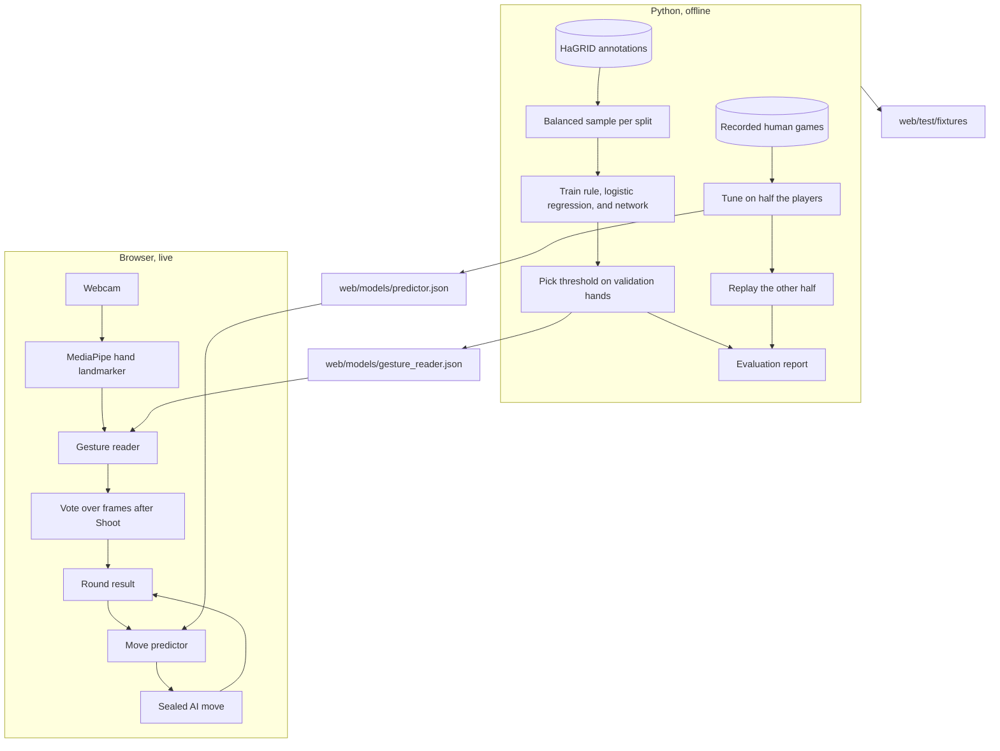

# Architecture

The project has two halves. A Python package trains the gesture reader, tunes the move predictor, and writes the evaluation report. A static web page runs the game: it reads the player's hand through the webcam, plays against them, and learns their habits. The two halves meet in three JSON files: the trained gesture reader, the predictor's settings, and the test fixtures that keep both implementations identical.

## Reading the hand

MediaPipe's hand landmarker finds 21 points on the hand in each video frame: the wrist and four joints per finger. The game never sees the image itself, only these points, and they never leave the browser.

The points arrive scaled to [0, 1] by the frame's width and height. Before classification, `canonicalise` in `landmarks.py` and `gesture.js` puts every hand in a standard position:

1. Multiply y by the frame's height over its width, so that both axes use the same unit.
2. Move the wrist to the origin.
3. Rotate the hand so that the base of the middle finger points straight up, and scale it so that this distance is 1.
4. Mirror the hand if needed so that the index finger is on the right. This makes left and right hands look alike, and palms and backs of hands too.

What remains is the hand's shape. The 20 points other than the wrist give 40 numbers, the input to a multilayer perceptron with two hidden layers of 64 ReLU units and a softmax over four classes: rock, paper, scissors, and not a move.

### Why landmarks and not pixels

A network on raw pixels would have to learn hand detection, lighting, skin tone, and background on top of the gesture. MediaPipe already solves those problems and runs in real time in a browser. Working from its landmarks leaves a small, well-defined problem: 40 numbers in, four classes out. The network has about 7,000 parameters, ships as a 70 KB JSON file, and runs in microseconds in plain JavaScript.

### The training data

HaGRID v2 labels over a million photos of hand gestures from tens of thousands of people, and its annotations include the MediaPipe landmarks of every hand. Only the annotations are downloaded (719 MB). The project uses HaGRID's own split by person, so no one appears in both training and test data.

Each class gets the same number of hands, spread evenly over its HaGRID labels:

| Class | HaGRID labels |
| --- | --- |
| Rock | fist |
| Paper | palm, stop, stop inverted, four |
| Scissors | peace, peace inverted, two up, two up inverted |
| Not a move | call, dislike, like, little finger, middle finger, mute, no gesture, ok, one, point, rock (the horns sign), three gun, thumb index |

Gestures between two moves, such as three fingers or a loose grip, are left out of training. The report shows what the reader makes of them. Two-handed gestures are left out entirely.

### The unknown aspect ratio

The annotations give landmarks scaled by each photo's width and height, but not the photo's size, so step 1 cannot be applied to the training data. Training therefore stretches every hand vertically by a random factor between 0.5 and 2, drawn evenly on a log scale, which covers both portrait and landscape photos. The report checks the result: the network's accuracy does not change across that range.

### Threshold and voting

The game would rather ask again than play a move the player did not show. The threshold is the lowest probability at which the reader plays at most 0.25% of validation hands as the wrong move, counting both a misread move and a non-move read as a move. Below it, the reading counts as unsure.

During a round, every frame in the 0.7 seconds after "Shoot!" is read. A move is played only when at least three frames, and at least 60% of all frames, agree on it. Otherwise the game asks the player to show their hand again, and the AI keeps its sealed move.

## Predicting the next move

The predictor learns each player from scratch during the game. Seven experts each model one possible habit and predict a probability for each move:

| Expert | Habit it looks for |
| --- | --- |
| No pattern | None: always one third each. It wins the combiner's trust when nothing else predicts well. |
| Favourite move | The move played most often recently |
| Cycling | A step from the last move (stay, up, or down) that the player keeps repeating |
| After a win or loss | The same steps, counted separately after a win, a draw, and a loss |
| After the last move | The move that has followed the player's last move |
| After the last two moves | The move that has followed the player's last two moves |
| Repeated sequence | The longest run of recent rounds, up to six, that happened before, and what followed it |

Counts shrink by a decay factor each time their situation recurs, so the experts follow a player who changes style. A prior count is added to every move, so an expert that has seen little stays close to one third.

An expert that reacts to the AI's last move is not needed. Given the result of a round and the player's move, the AI's move is fixed, so such an expert would make the same predictions as the after-a-win-or-loss expert. An early version had one and the evaluation showed identical numbers.

### Combining the experts

The combiner keeps a decayed sum of each expert's log loss on the rounds so far and weights the experts by `exp(-learning_rate * (loss - best_loss))`. The forecast is the weighted average of their predictions. Log loss rewards honest probabilities, so an expert that is confidently wrong loses trust quickly.

### Choosing the AI's move

Against a forecast `q`, the expected score of a move is the chance it wins minus the chance it loses. The AI plays the move with the best expected score. When no move scores above a margin, it plays at random, which cannot lose on average. Ties are broken with a random number.

### Why not a trained sequence model

A recurrent network trained on recorded games would start each game with a prior about how people play. The only large dataset of recorded games found has no licence, so it is used for evaluation only, and nothing shipped in the game is trained on it except five tuned settings. The online experts need no training data, adapt to each player within a few rounds, and can explain their predictions in a sentence.

## Proving the AI does not cheat

A program that sees the webcam could wait for the player's hand. To show that it does not, the game commits to its move before each round:

1. The AI chooses its move and a random 16-byte code.
2. It shows the SHA-256 hash of the text `move:code`, for example `paper:3f0a...`.
3. After the player's move is read, it reveals the text. Anyone can hash it and compare.

Without the code, the three possible hashes could be computed in advance and the move read off the screen. The end-to-end test checks the commitment of every round of a full match.

## Two implementations, one behaviour

The predictor and the gesture reader exist in Python, for training and evaluation, and in JavaScript, for the game. A difference between them would make the evaluation describe a different program from the one people play. `scripts/train_and_evaluate.py` therefore writes fixtures:

- `predictor_cases.json`: games against scripted players with every forecast, weight, and move, for two sets of settings.
- `gesture_cases.json`: random landmark sets with the features, probabilities, and decision of the shipped network.

The JavaScript tests replay them and require agreement to 1e-12 for the predictor and 1e-9 for the network, whose matrix products NumPy sums in a different order. A Python test checks that the committed fixtures still match the current Python code, so neither side can change alone.

## Evaluation

The recorded games come from Komai, Kurokawa, and Kim (2022): 500 people, 50 rounds each, against a computer program. One player's file has 49 computer moves for 50 player moves and is left out. The remaining 499 players are split at random, half for tuning and half for testing.

In a replay, the AI predicts each move from the history the player actually saw and plays its move, which only decides the score. This measures how well it predicts real people. It does not show how they would react to it, because they faced a different program.

Settings are tuned by mean log loss over a grid of decay, prior, learning rate, and score decay. Log loss is much less noisy than wins, which move in thirds of a point. The margin only changes which move is played, so it is chosen afterwards by net score. Results are reported with 95% bootstrap intervals that resample players, because the rounds of one player are related.

## Code layout

| Module | Role |
| --- | --- |
| `config.py` | Typed settings from `config/config.yaml` |
| `downloads.py` | Downloads pinned by SHA-256 |
| `hagrid.py` | Landmarks from the annotation archive, balanced samples |
| `landmarks.py` | Canonical hand positions, features, stretches |
| `gestures.py` | The finger-counting rule, the network, thresholds, metrics |
| `gesture_pipeline.py` | Training and testing the readers |
| `humans.py` | Loading and splitting the recorded games |
| `moves.py` | Move encoding and outcomes |
| `predictors.py` | The experts, the combiner, and the move choice |
| `simulation.py` | Replays, bootstrap intervals, tuning |
| `predictor_pipeline.py` | Tuning and testing the predictor |
| `export.py` | Game files and parity fixtures |
| `plotting.py`, `reporting.py` | Figures and the evaluation report |
| `pipeline.py` | Everything above in order |

| Web file | Role |
| --- | --- |
| `index.html`, `styles.css` | The page |
| `src/main.js` | Wiring: modes, countdown, rounds, summary |
| `src/camera.js` | Webcam and MediaPipe |
| `src/gesture.js` | Canonical landmarks, the network, voting |
| `src/predictor.js` | The predictor |
| `src/match.js` | A match: sealing, scoring, summary |
| `src/explain.js` | The sentence under "Why" |
| `src/commitment.js` | SHA-256 commit and reveal |

## Decisions

- **No server.** The game is a static page on GitHub Pages. There is nothing to run, scale, or secure, and no player data to store.
- **No build step.** The page uses plain ES modules, type checked with TypeScript through JSDoc comments. What the tests check is exactly what the browser runs.
- **MediaPipe from a CDN, pinned.** The WebAssembly runtime comes from jsDelivr at version 1.2.0 and the hand model from Google's model storage, version 1. Vendoring them would add 22 MB of binaries to the repository.
- **Pinned dependencies.** `uv.lock` and `package-lock.json` pin every package, uv resolves against a fixed date, and CI actions are pinned to commit SHAs.
- **Downloads verified.** Both datasets are pinned by SHA-256, and the human games by a commit of their repository.
