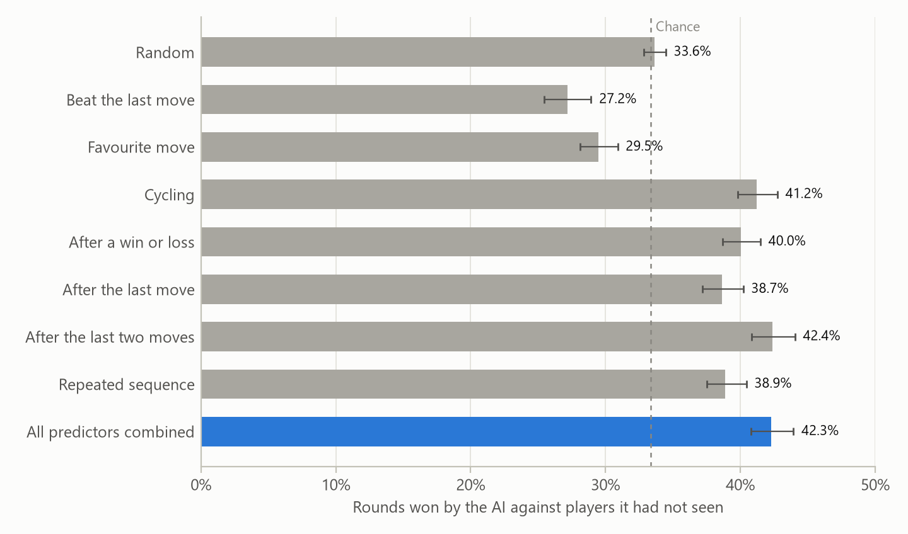
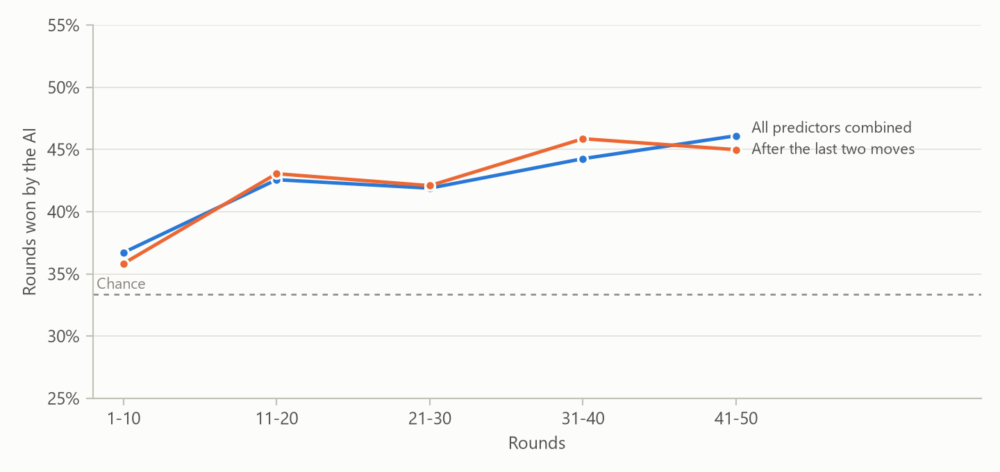
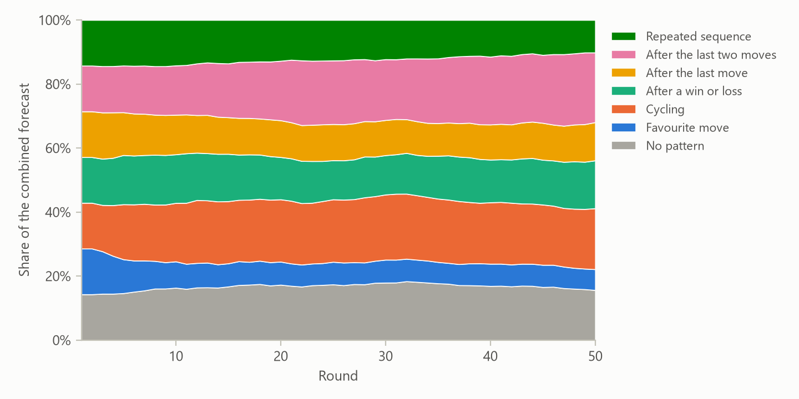
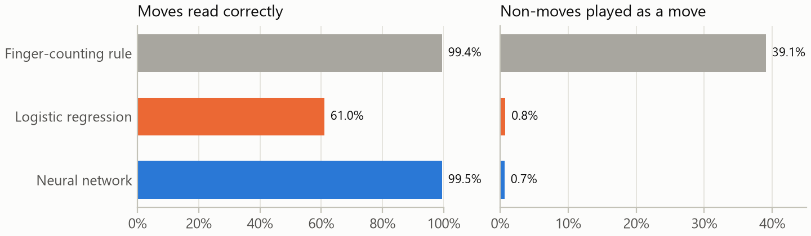
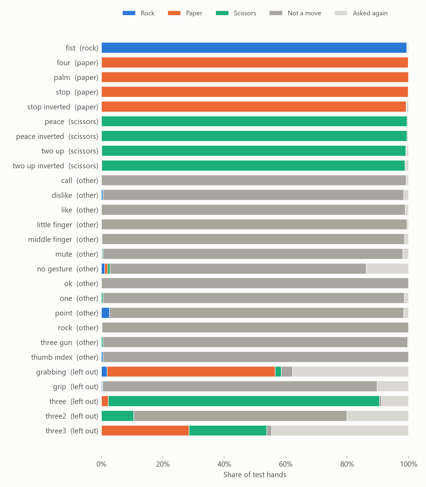
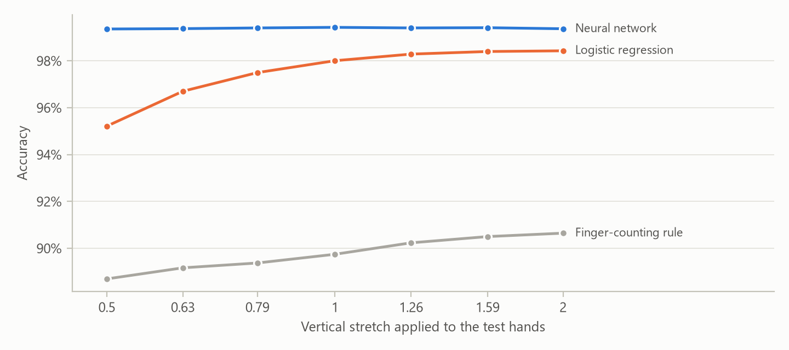
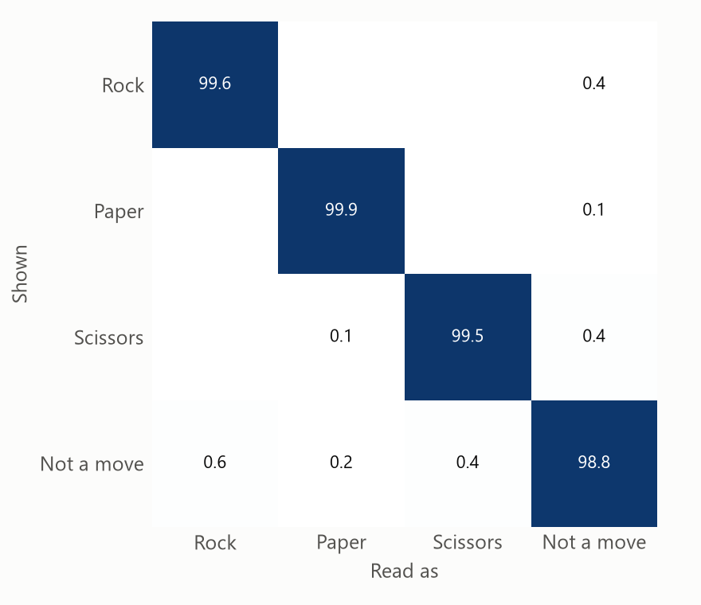

# Evaluation report

Generated by `scripts/train_and_evaluate.py`. Rerun the script rather than editing this file.

## Gesture reader

Hands come from the HaGRID v2 annotations, split by person, so no one appears in more than one split. Each class has the same number of hands, spread evenly over its HaGRID labels.

| Split | Hands | People |
| --- | --- | --- |
| Training | 80,000 | 17,473 |
| Validation | 11,923 | 1,300 |
| Test | 19,877 | 2,236 |

The game uses the neural network: hidden layers of 64 and 64 units, 7,044 parameters. Each reader's threshold is the lowest at which it plays at most 0.25% of validation hands as a move the player did not show.

| Reader | Accuracy | Macro F1 | Threshold | Moves read correctly | Moves asked again | Non-moves played as a move | Wrong moves |
| --- | --- | --- | --- | --- | --- | --- | --- |
| Finger-counting rule | 89.75% | 0.8891 | none | 99.44% | 0.40% | 39.08% | 9.96% |
| Logistic regression | 98.01% | 0.9800 | 0.98 | 61.01% | 38.97% | 0.78% | 0.21% |
| Neural network | 99.43% | 0.9943 | 0.81 | 99.46% | 0.50% | 0.66% | 0.20% |

- **Moves read correctly**: rock, paper, and scissors hands read as the right move.
- **Moves asked again**: move hands read as not a move or below the threshold. The game asks the player to show their hand again.
- **Non-moves played as a move**: thumbs up, pointing, relaxed hands, and other non-moves that the game would play as rock, paper, or scissors.
- **Wrong moves**: hands of any class played as a move the player did not show.

### By HaGRID label

Labels marked left out are between two moves, such as three fingers, and were not used in training.

| HaGRID label | Class | Hands | Rock | Paper | Scissors | Not a move | Asked again |
| --- | --- | --- | --- | --- | --- | --- | --- |
| fist | rock | 4,877 | 99.4% | 0.0% | 0.0% | 0.2% | 0.4% |
| four | paper | 1,250 | 0.0% | 99.9% | 0.1% | 0.0% | 0.0% |
| palm | paper | 1,250 | 0.0% | 100.0% | 0.0% | 0.0% | 0.0% |
| stop | paper | 1,250 | 0.0% | 99.9% | 0.0% | 0.0% | 0.1% |
| stop inverted | paper | 1,250 | 0.0% | 99.2% | 0.0% | 0.1% | 0.7% |
| peace | scissors | 1,250 | 0.0% | 0.0% | 99.5% | 0.3% | 0.2% |
| peace inverted | scissors | 1,250 | 0.0% | 0.0% | 99.5% | 0.2% | 0.2% |
| two up | scissors | 1,250 | 0.1% | 0.1% | 99.0% | 0.2% | 0.6% |
| two up inverted | scissors | 1,250 | 0.0% | 0.1% | 98.8% | 0.2% | 0.9% |
| call | other | 385 | 0.0% | 0.0% | 0.0% | 99.2% | 0.8% |
| dislike | other | 385 | 0.5% | 0.0% | 0.0% | 97.9% | 1.6% |
| like | other | 385 | 0.0% | 0.0% | 0.0% | 99.0% | 1.0% |
| little finger | other | 385 | 0.0% | 0.0% | 0.0% | 99.5% | 0.5% |
| middle finger | other | 385 | 0.0% | 0.0% | 0.3% | 98.4% | 1.3% |
| mute | other | 385 | 0.3% | 0.0% | 0.3% | 97.7% | 1.8% |
| no gesture | other | 385 | 1.0% | 1.0% | 0.8% | 83.4% | 13.8% |
| ok | other | 385 | 0.0% | 0.0% | 0.0% | 100.0% | 0.0% |
| one | other | 384 | 0.0% | 0.0% | 0.5% | 98.2% | 1.3% |
| point | other | 384 | 2.6% | 0.0% | 0.0% | 95.8% | 1.6% |
| rock | other | 384 | 0.0% | 0.0% | 0.3% | 99.7% | 0.0% |
| three gun | other | 384 | 0.0% | 0.0% | 0.5% | 99.2% | 0.3% |
| thumb index | other | 384 | 0.5% | 0.0% | 0.0% | 99.5% | 0.0% |
| grabbing | left out | 1,000 | 1.9% | 54.7% | 2.0% | 3.6% | 37.8% |
| grip | left out | 1,000 | 0.3% | 0.0% | 0.1% | 89.4% | 10.2% |
| three | left out | 1,000 | 0.0% | 2.2% | 88.4% | 0.6% | 8.8% |
| three2 | left out | 1,000 | 0.0% | 0.0% | 10.5% | 69.5% | 20.0% |
| three3 | left out | 1,000 | 0.0% | 28.5% | 25.4% | 1.5% | 44.6% |

### Image shape

The annotations do not record each photo's aspect ratio, so the readers were trained on hands stretched vertically by random factors between 0.5 and 2. Accuracy on test hands stretched by each factor:

| Reader | 0.5 | 0.63 | 0.79 | 1 | 1.26 | 1.59 | 2 |
| --- | --- | --- | --- | --- | --- | --- | --- |
| Finger-counting rule | 88.7% | 89.2% | 89.4% | 89.7% | 90.2% | 90.5% | 90.6% |
| Logistic regression | 95.2% | 96.7% | 97.5% | 98.0% | 98.3% | 98.4% | 98.4% |
| Neural network | 99.4% | 99.4% | 99.4% | 99.4% | 99.4% | 99.4% | 99.4% |

## Move predictor

The recorded games come from Komai, Kurokawa, and Kim (2022). Players are split at random: settings are tuned on one half and every number below comes from the other half. The AI predicts each move from the history the player actually saw, so the results show how well it predicts real people, not how they would react to it.

| Setting | Value |
| --- | --- |
| Players | 499 with 50 rounds each |
| Players left out | number 294: the files of player and computer moves differ in length |
| Tuning players | 250 |
| Test players | 249 |
| Count decay | 0.9 |
| Prior count | 1 |
| Combiner learning rate | 1 |
| Combiner score decay | 0.95 |
| Longest pattern | 6 rounds |
| Margin before playing at random | 0 |

Settings are chosen by the lowest log loss on the tuning players, then the margin by the highest net score. The best tuning log loss was 1.0282; random guessing scores 1.0986.

### Results on the test players

Intervals are 95% bootstrap intervals over players. The net score is the share of rounds won minus the share lost.

| AI strategy | Won | Drawn | Lost | Net score | Predicted the move | Log loss |
| --- | --- | --- | --- | --- | --- | --- |
| Random | 33.6% (32.8 to 34.5) | 33.0% | 33.4% | +0.3% (-1.1 to +1.7) | n/a | n/a |
| Beat the last move | 27.2% (25.4 to 28.9) | 35.9% | 37.0% | -9.8% (-12.7 to -7.0) | n/a | n/a |
| Favourite move | 29.5% (28.1 to 30.9) | 31.7% | 38.8% | -9.4% (-11.8 to -6.8) | 28.2% | 1.1551 |
| Cycling | 41.2% (39.8 to 42.7) | 31.9% | 26.9% | +14.3% (+12.0 to +16.8) | 42.1% | 1.0665 |
| After a win or loss | 40.0% (38.7 to 41.5) | 32.8% | 27.2% | +12.9% (+10.7 to +15.2) | 40.2% | 1.0871 |
| After the last move | 38.7% (37.2 to 40.2) | 32.5% | 28.8% | +9.8% (+7.4 to +12.4) | 38.4% | 1.0919 |
| After the last two moves | 42.4% (40.9 to 44.0) | 30.3% | 27.3% | +15.0% (+12.7 to +17.7) | 42.8% | 1.0642 |
| Repeated sequence | 38.9% (37.5 to 40.4) | 31.1% | 30.0% | +8.9% (+6.6 to +11.5) | 39.2% | 1.1038 |
| All predictors combined | 42.3% (40.8 to 43.9) | 30.6% | 27.1% | +15.2% (+12.8 to +17.9) | 43.2% | 1.0504 |

### Win rate by round

| AI strategy | 1-10 | 11-20 | 21-30 | 31-40 | 41-50 |
| --- | --- | --- | --- | --- | --- |
| Random | 34.2% | 32.9% | 33.8% | 34.6% | 32.8% |
| Beat the last move | 25.7% | 26.8% | 27.9% | 27.6% | 27.9% |
| Favourite move | 28.0% | 28.7% | 30.6% | 29.9% | 30.2% |
| Cycling | 40.0% | 42.3% | 41.1% | 40.7% | 41.9% |
| After a win or loss | 37.9% | 40.1% | 39.1% | 41.2% | 41.9% |
| After the last move | 34.0% | 38.9% | 39.2% | 40.4% | 40.7% |
| After the last two moves | 35.8% | 43.1% | 42.1% | 45.9% | 45.0% |
| Repeated sequence | 34.5% | 38.1% | 40.6% | 40.4% | 40.8% |
| All predictors combined | 36.7% | 42.6% | 41.9% | 44.3% | 46.1% |

### What the combined forecast relies on

| Predictor | Share of the forecast in the last round |
| --- | --- |
| After the last two moves | 21.8% |
| Cycling | 19.0% |
| No pattern | 15.6% |
| After a win or loss | 15.0% |
| After the last move | 11.9% |
| Repeated sequence | 10.2% |
| Favourite move | 6.5% |

### How the recorded players played

Across all 499 players, 32.2% of moves were rock, 32.7% paper, and 35.1% scissors. Players repeated their previous move in 28.2% of rounds, less than the 33.3% of random play. They repeated 30.6% of the time after a win, 27.8% after a draw, and 26.5% after a loss.

The dataset does not document which number is which move. These figures assume the encoding of the authors' later work: 0 rock, 1 scissors, 2 paper. Prediction accuracy and log loss do not depend on that assumption, because every predictor treats the three moves alike. Wins do, slightly: with paper and scissors swapped, the combined AI would win 42.1% of rounds instead of 42.3%.

## Figures

### AI strategies against the test players

### Learning a player during a game

### What the combined forecast relies on

### Three ways of reading hands

### Reading every HaGRID gesture

### Robustness to image shape

### Neural network: hand shown against hand read

